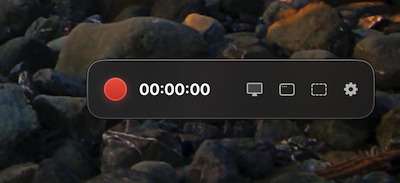
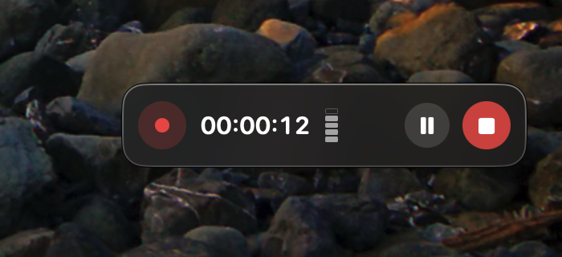
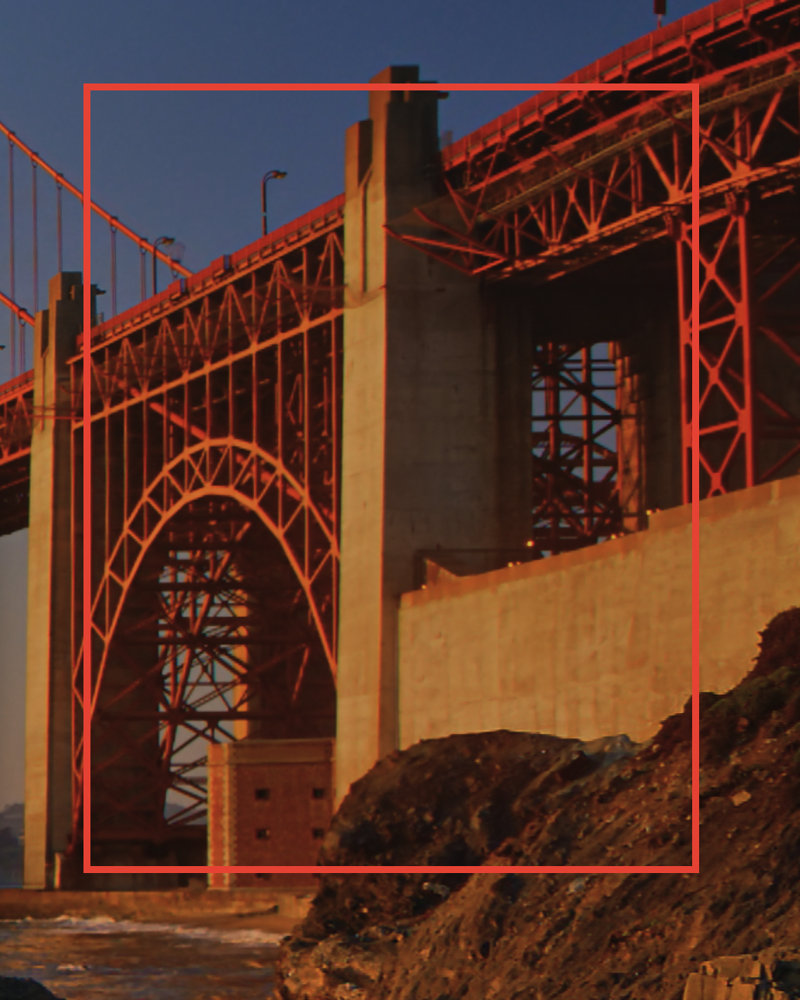
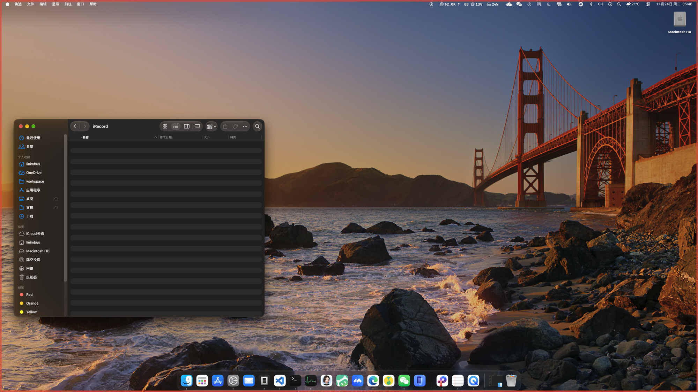
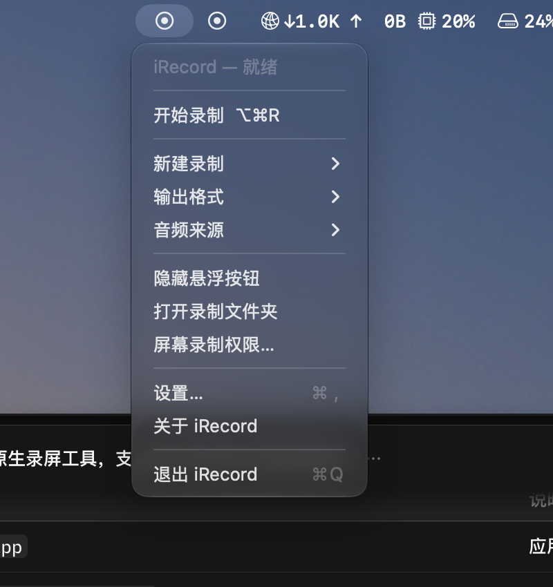
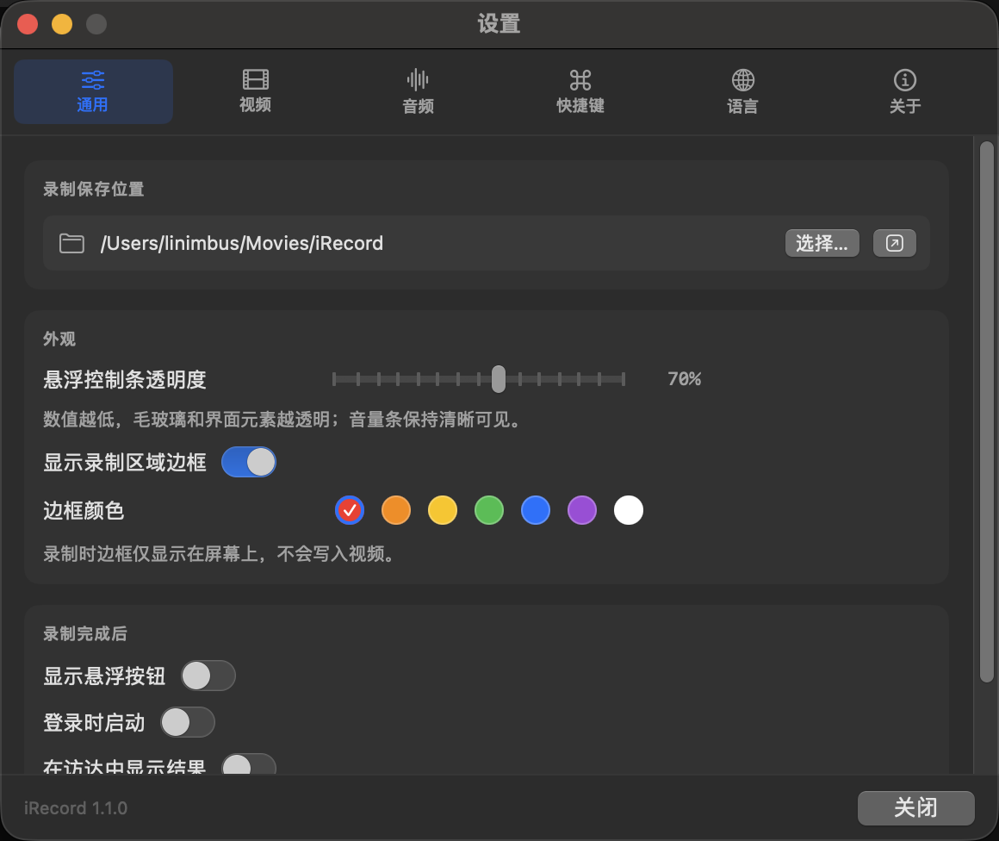
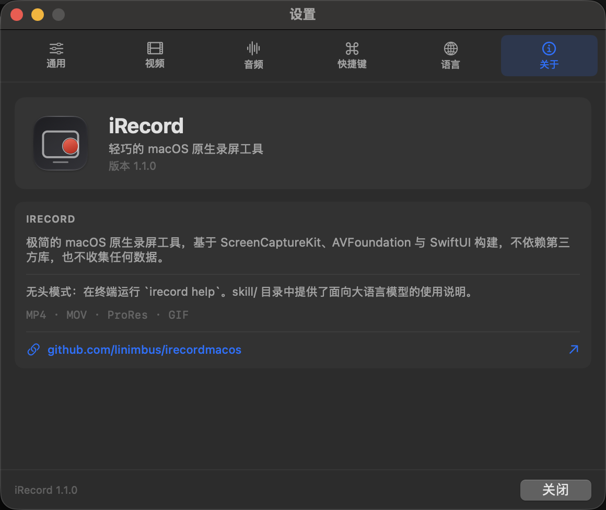

# iRecord · macOS 原生极简录屏

> **v1.1.0** · 菜单栏 / 右下角悬浮按钮 · 全屏 / 窗口 / 区域录制 · 系统音频与麦克风 · MP4 / MOV / ProRes / GIF · 无头 CLI

[English README](README_en.md) · [无头模式 Skill](skill/irecord-headless/SKILL.md) · [GitHub 项目](https://github.com/linimbus/irecordmacos)

iRecord 是一个使用 macOS 系统框架构建的轻量录屏工具。启动后没有 Dock 图标，只在菜单栏右上角和屏幕右下角提供一个紧凑的控制入口。它基于 ScreenCaptureKit 录制画面与系统声音，使用 AVFoundation 编码视频，使用 ImageIO 生成 GIF，不依赖 FFmpeg 或任何第三方库，也不包含遥测与联网行为。

---

## 功能特性

- **三种录制范围**
  - 全屏（当前鼠标所在显示器）
  - 指定窗口（列表选择，支持按应用/标题筛选）
  - 自定义区域（拖拽框选，`Return` 确认，`Esc` 取消）
- **桌面控制**
  - 菜单栏状态图标：就绪 / 录制中 / 暂停 / 保存中
  - 右下角**毛玻璃**悬浮控制条：单点录制按钮、全屏、窗口、区域、设置；未录制时也显示 `00:00:00` 计时；录制中显示 `HH:MM:SS` 计时、五格垂直音量电平条、暂停/恢复、停止
  - 悬浮控制条与录制区域选择层设置 `sharingType = .none`，**不会出现在录制画面中**
- **全局快捷键**（可在设置中重新录制）
  - `⌥⌘R` 开始 / 停止录制
  - `⌥⌘P` 暂停 / 恢复
  - `⌥⌘S` 停止并保存
- **音频**
  - 无音频 / 系统声音 / 麦克风 / 系统声音 + 麦克风
  - 系统声音通过 ScreenCaptureKit 捕获；麦克风通过独立的 AVAudioEngine 采集，不依赖 ScreenCaptureKit 的麦克风混合
- **鼠标**
  - 可显示或隐藏鼠标指针
  - 可开启 **鼠标点击高亮**：由系统在每个点击位置绘制圆形高亮，并直接写入视频
- **录制区域边框**
  - 全屏或区域录制时，在屏幕上显示所选颜色的边框
  - 停止录制立即消失
  - 边框只显示在屏幕上，**不会写入录像**
  - 颜色可在设置中选择：红、橙、黄、绿、蓝、紫、白
- **多种输出格式**
  - MP4 · H.264
  - MP4 · HEVC
  - MOV · H.264
  - MOV · HEVC
  - MOV · ProRes 422
  - GIF（停止后自动转换，可设置最大宽度与帧率）
- **录制控制**
  - 暂停 / 恢复会从最终文件中剪掉暂停期间的时长
  - 静态画面也会保持完整时长
  - 停止后自动保存、可选播放提示音、在 Finder 中显示、发送系统通知
- **设置界面**
  - 紧凑的六个标签页：通用、视频、音频、快捷键、语言、关于
  - 7 种界面语言，切换立即生效：
    English, 简体中文, 日本語, 한국어, Deutsch, Français, Español（另有“跟随系统”）
- **无头模式**
  - `irecord` 命令行支持同步录制、后台会话、暂停/恢复/停止、目标枚举、权限检查
  - 所有命令支持 `--json`，stdout 始终只输出一个 JSON 对象，便于大语言模型/自动化调用
  - `irecord help --json` 提供完整的机器可读能力说明

---

## 截图

### 桌面控制条（空闲）



毛玻璃控制条：`00:00:00` 计时、全屏、窗口、区域、设置。

### 录制中



录制中显示计时、五格灰色音量条、暂停和停止；音量条不受界面透明度影响。

### 录制区域边框



区域录制时在屏幕上显示边框，停止后立即消失，不写入视频。

### 全屏录制边框



全屏录制同样显示边框；颜色可在设置 → 通用 → 外观中选择。

### 菜单栏



菜单栏图标与菜单：开始录制、新建录制、输出格式、音频来源、设置和退出。

### 设置



设置 → 通用 → 外观：悬浮控制条透明度、录制区域边框开关与颜色。

### 关于



设置 → 关于：版本号与 [GitHub 项目链接](https://github.com/linimbus/irecordmacos)。

---

## 系统要求

- macOS **15.0** 或更高版本
- Apple Silicon 或 Intel Mac（发布包为 Universal 2）
- 屏幕录制权限；使用麦克风时需要麦克风权限
- 从源码构建：Xcode 16+ / Swift 5.10+（本项目在 Xcode 27.2 / Swift 6.4 下验证）

---

## 安装与首次运行

### 使用发布包

1. 打开 `dist/iRecord-1.1.0-macOS.dmg`，把 **iRecord.app** 拖入“应用程序”。
2. 由于发布包使用 ad-hoc 签名，首次打开需要：
   - 在 Finder 中右键点击 iRecord.app → **打开**，或
   - 执行 `xattr -dr com.apple.quarantine /Applications/iRecord.app`
3. 启动后应用不会出现在 Dock 中：
   - 菜单栏右上角出现圆形录制图标
   - 屏幕右下角出现悬浮控制条
4. 首次录制时系统会请求 **屏幕录制** 权限。授权后如果仍无法录制，请退出并重新打开 iRecord。
5. 使用麦克风时，请在“系统设置 → 隐私与安全性 → 麦克风”中允许 iRecord。

> 提示：重新构建 ad-hoc 签名的应用后，macOS 可能把它视为新的二进制，需要重新授权屏幕录制。

### 使用命令行版本

CLI 同时包含在应用包内：

```bash
/Applications/iRecord.app/Contents/Helpers/irecord help
```

也可以把 `dist/irecord` 复制到 PATH：

```bash
sudo cp dist/irecord /usr/local/bin/irecord
irecord help --json
```

更推荐直接使用应用包内的版本，因为它带有完整的 Bundle 信息与麦克风用途说明。

---

## 使用方式

### 开始录制

任选一种：

- 点击右下角悬浮条上的红色录制按钮：**全屏**
- 点击悬浮条上的窗口图标：**选择窗口**
- 点击悬浮条上的区域图标：**框选区域**
- 菜单栏图标 → **新建录制** → 全屏 / 窗口 / 区域
- 快捷键 `⌥⌘R`：开始/停止全屏录制

如果悬浮条处于隐藏状态，开始录制时会自动显示，录制结束后恢复隐藏。

### 录制过程中

- 悬浮条自动切换为：录制计时、暂停/恢复按钮、停止按钮
- `⌥⌘P` 暂停或继续
- `⌥⌘S` 或点击停止按钮结束并保存
- 菜单栏图标变为红色圆点；暂停时变为橙色暂停符号

### 输出位置

默认保存到 `~/Movies/iRecord/`，文件名形如 `iRecord-2026-11-23-22-10-05.mp4`。可以在设置中更换目录。

---

## 输出格式说明

| 格式 | 容器 | 编码 | 音频 | 说明 |
| --- | --- | --- | --- | --- |
| `mp4-h264` | MP4 | H.264 | AAC | 默认，兼容性最好 |
| `mp4-hevc` | MP4 | HEVC | AAC | 同画质下体积更小 |
| `mov-h264` | MOV | H.264 | AAC | QuickTime 原生容器 |
| `mov-hevc` | MOV | HEVC | AAC | QuickTime + HEVC |
| `mov-prores` | MOV | ProRes 422 | AAC | 剪辑素材，文件很大 |
| `gif` | GIF | - | 无 | 停止后转换；可设最大宽度与帧率 |

- GIF 不包含声音，设置界面会给出提示。
- 长 GIF 会自动限制总帧数（最多约 1200 帧）以控制转换时间和内存。
- ProRes 适合二次剪辑，不建议用于快速分享。

### 关于声音的采集范围

- **全屏 / 区域录制**：系统声音来自当前输出设备，覆盖整个系统。
- **窗口录制**：ScreenCaptureKit 只捕获**被录制窗口所属应用**的声音。如果窗口本身没有播放声音，录出的音轨会是静音；如需整个系统的声音，请使用全屏或区域录制。
- **麦克风**：选择“麦克风”时写入独立的麦克风音轨；选择“系统声音 + 麦克风”时，文件包含两条音轨——麦克风为第一音轨，系统声音为第二音轨。需要麦克风权限。
- **GIF**：始终无音频。

---

## 设置

设置窗口是固定尺寸的紧凑布局，包含：

- **通用**：保存目录、默认格式、帧率、画质、悬浮条、悬浮条透明度、录制区域边框开关与颜色、登录时启动、完成后在 Finder 显示、完成提示音
- **视频**：格式、缩放（100% / 75% / 50%）、帧率、画质、GIF 宽度/帧率、鼠标指针、鼠标点击高亮
- **音频**：无音频 / 系统声音 / 麦克风 / 系统声音 + 麦克风，麦克风权限快捷入口
- **快捷键**：点击快捷键框后按下新组合；检测重复；一键恢复默认
- **语言**：English / 简体中文 / 日本語 / 한국어 / Deutsch / Français / Español / 跟随系统
- **关于**：版本、项目说明、CLI 入口提示

快捷键使用 Carbon 热键注册，不需要辅助功能权限，在整个系统中生效（应用运行期间）。

---

## 无头模式（供大语言模型 / 自动化调用）

`irecord` 是独立进程，不需要启动图形界面。所有命令都支持 `--json`，stdout 只输出一个 JSON 对象，进度信息写入 stderr。

```bash
# 1. 检查权限与环境
irecord doctor --json

# 2. 发现显示器与窗口（窗口 ID 是临时的，录制前请重新获取）
irecord targets --json

# 3. 同步录制 8 秒全屏
irecord record --mode screen --duration 8 --output demo.mp4 --json

# 4. 录制指定窗口，包含系统声音 + 麦克风，并高亮鼠标点击
irecord record --mode window --window 12345 --duration 5 \
  --audio both --mouse-clicks --json

# 5. 按应用/标题选择窗口
irecord record --mode window --app Safari --title "Example" --duration 10 --json

# 6. 录制显示器 1 的左上角 800×600 区域为 GIF
irecord record --mode region --display 1 --region 100,200,800,600 \
  --duration 6 --format gif --json

# 7. 后台会话：开始后立即返回 session id
irecord start --mode screen --output session.mp4 --json
irecord status --session <id> --json
irecord pause  --session <id> --json
irecord resume --session <id> --json
irecord stop   --session <id> --json     # 等待完成/转换并返回最终结果
```

### 命令一览

| 命令 | 作用 |
| --- | --- |
| `irecord help [--json]` | 人类可读帮助 / 完整机器可读能力声明 |
| `irecord doctor [--json]` | 检查版本、权限、输出目录、活动会话 |
| `irecord targets [--json]` | 列出显示器和可录制窗口 |
| `irecord record [options]` | 同步录制；交互式终端可用 `Ctrl+C` 结束，非交互环境必须提供 `--duration` |
| `irecord start [options]` | 启动后台会话，立即返回 session id |
| `irecord pause/resume/stop/status` | 控制后台会话 |
| `irecord config [--json]` | 查看与图形界面共享的设置 |
| `irecord version` | 输出 `iRecord 1.1.0` |

### JSON 输出示例

成功：

```json
{
  "ok": true,
  "output": "/Users/me/Movies/iRecord/iRecord-2026-11-23-22-10-05.mp4",
  "format": "mp4-h264",
  "duration": 8.02,
  "width": 3024,
  "height": 1964,
  "fileSize": 5242880,
  "audio": true
}
```

失败：

```json
{
  "ok": false,
  "error": "Screen Recording permission is not granted.",
  "code": "screen_permission_denied",
  "hint": "Open System Settings → Privacy & Security → Screen Recording..."
}
```

后台会话状态由 `~/Library/Application Support/iRecord/sessions/<id>.json` 持久化；`stop` 命令会轮询该文件直到完成。默认超时 300 秒，可用 `--timeout` 调整。

### 退出码

| 退出码 | 含义 |
| --- | --- |
| 0 | 成功 |
| 1 | 一般错误 |
| 2 | 参数错误 |
| 3 | 缺少屏幕录制或麦克风权限 |
| 4 | 找不到目标显示器 / 窗口 / 区域 |
| 5 | 输出路径不可写或文件已存在 |
| 6 | 等待超时 |
| 130 | 被 `Ctrl+C` 取消 |

### 权限注意事项

- **屏幕录制权限归属于运行 `irecord` 的进程**。通常需要在“系统设置 → 隐私与安全性 → 屏幕录制”中启用 Terminal、iTerm、IDE 或你的自动化宿主，而不是 iRecord 本身。
- 授权后可能需要重启终端/宿主进程。
- 麦克风录制建议使用 `/Applications/iRecord.app/Contents/Helpers/irecord`（应用包内版本），或先通过图形界面授权。独立二进制已内嵌 `NSMicrophoneUsageDescription`。
- 后台 `start` 会使用 `setsid` 脱离终端。某些环境下 TCC 无法给脱离终端的新进程弹窗，此时请改用同步的 `record --duration N`。
- 无 `--duration` 的前台 `record` 仅在交互式终端中允许，避免自动化流程无限挂起。
- 窗口录制时系统声音只包含被录制应用的声音；需要整个系统的声音请使用全屏/区域录制。

### 给大语言模型的入口

- 机器可读能力说明：`irecord help --json`
- 面向 Agent 的完整工作流与错误恢复指南：[`skill/irecord-headless/SKILL.md`](skill/irecord-headless/SKILL.md)
- 推荐循环：`doctor` → `targets` → `record --duration` → 检查 `ok` 与 `output`

---

## 从源码构建

### 一键发布

```bash
./release.sh
```

脚本会自动完成：

- 运行单元测试
- Universal 2（arm64 + x86_64）构建
- 签名 `.app`
- 生成 `.app`、`.zip`、`.dmg`、独立 CLI
- 生成 `SHA256SUMS.txt`
- 校验签名、版本号、架构、DMG 内容与校验和

常用选项：

```bash
./release.sh --open          # 完成后打开 dist 文件夹
./release.sh --no-tests      # 跳过测试
CODESIGN_IDENTITY="Developer ID Application: ..." ./release.sh
```

也可以使用 `make release` 调用同一脚本。

### 手动构建

```bash
git clone <repository> iRecordMacOS
cd iRecordMacOS

swift build                 # 调试构建
swift test                  # 单元测试
make dist                   # 生成 universal 发布包（arm64 + x86_64）
open dist/iRecord.app
```

产物：

- `dist/iRecord.app` — 应用本体（内置 CLI 于 `Contents/Helpers/irecord`）
- `dist/irecord` — 独立 CLI
- `dist/iRecord-1.1.0-macOS.zip` — 便携压缩包
- `dist/iRecord-1.1.0-macOS.dmg` — 安装镜像（含 README、LICENSE、Skill、Applications 快捷方式和独立 `CLI/irecord`）
- `dist/SHA256SUMS.txt` — 校验和

如需再签名/公证：

```bash
CODESIGN_IDENTITY="Developer ID Application: ..." make dist
```

当前仓库的发布包默认使用 ad-hoc 签名，不包含 Apple 公证。

---

## 项目结构

```
.
├── Package.swift
├── Sources
│   ├── iRecordCore          # 录制引擎、设置、本地化、GIF、快捷键、控制协议
│   ├── iRecordApp           # 菜单栏 App、悬浮条、设置、窗口/区域选择
│   └── iRecordCLI           # irecord 无头命令行与后台会话
├── Tests/iRecordCoreTests
├── Resources                # Info.plist、entitlements、图标
├── scripts                  # build.sh、图标生成脚本
├── skill/irecord-headless   # 面向 LLM 的 Skill
├── dist                     # 构建产物
├── README.md
└── README_en.md
```

技术栈全部来自系统：

- ScreenCaptureKit：屏幕/窗口/区域采集、系统声音、鼠标点击高亮
- AVAudioEngine：独立麦克风采集
- AVFoundation：AVAssetWriter（H.264/HEVC/ProRes + AAC）
- ImageIO：GIF 编码
- SwiftUI + AppKit：菜单栏、悬浮条、设置、选区
- Carbon：全局快捷键
- POSIX Unix Domain Socket：CLI 后台会话控制

---

## 隐私

- 全部处理在本地完成，不联网、不收集数据、无分析埋点。
- 设置和会话记录保存在 `~/Library/Application Support/iRecord/`。
- 录制的文件保存在你选择的目录中。
- 屏幕内容可能包含隐私信息，请自行确认录制范围与保存位置。

---

## 已知限制

- 受 macOS 保护的窗口（如部分密码输入、DRM 内容）可能无法录制或显示为黑屏。
- 全屏录制一次只录一个显示器；多显示器请分别录制或使用区域/窗口模式。
- GIF 不包含音频，长录制的转换需要时间。
- 发布包为 ad-hoc 签名；跨机器分发时 Gatekeeper 会提示，需要右键打开。
- 无头模式的屏幕录制权限由宿主进程持有；不同终端/自动化环境可能需要在系统设置中单独授权。
- 录制开始时，隐藏的悬浮条会自动显示；录制中再次隐藏后，仍可通过菜单栏图标或快捷键控制。

---

## 版本

**1.1.0** — 新增录制区域/全屏边框与颜色选择、悬浮条透明度、五格灰色音量条、独立麦克风采集、全屏按钮、空闲 `00:00:00` 计时、毛玻璃控制条、一键发布脚本；修复麦克风音轨、音量显示与界面崩溃问题。

## License

MIT License。详见 [LICENSE](LICENSE)。
