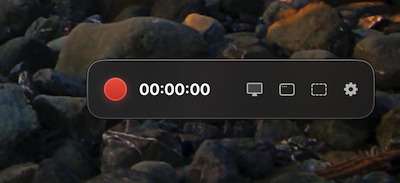
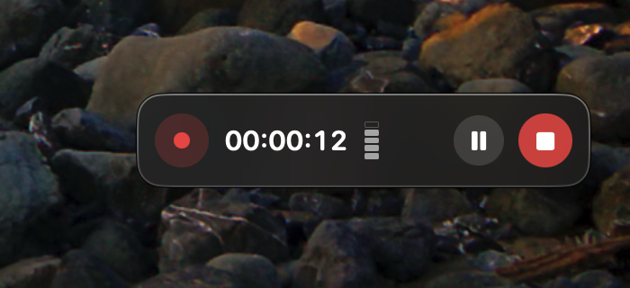
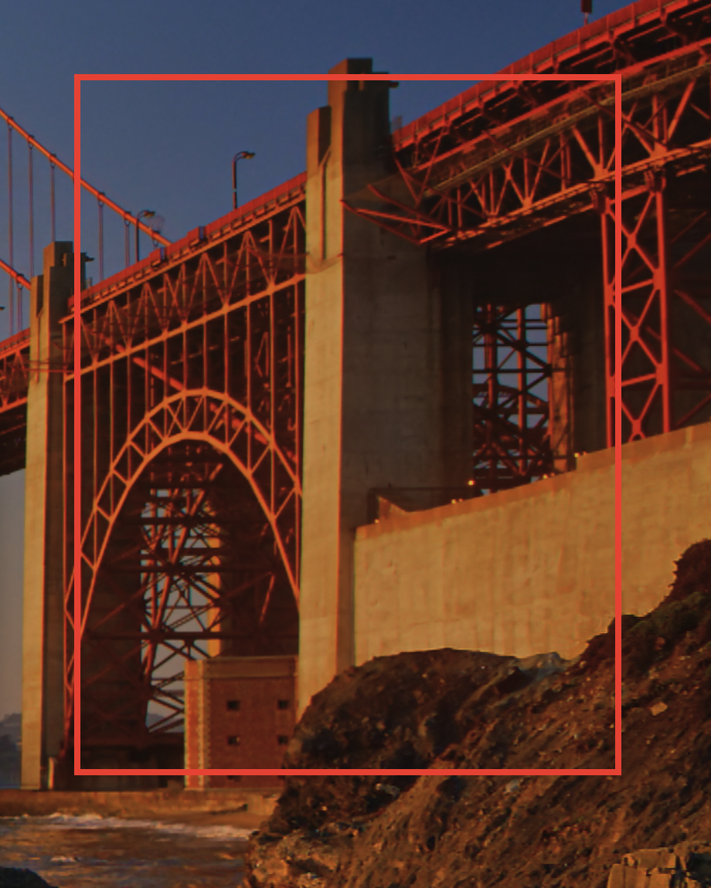
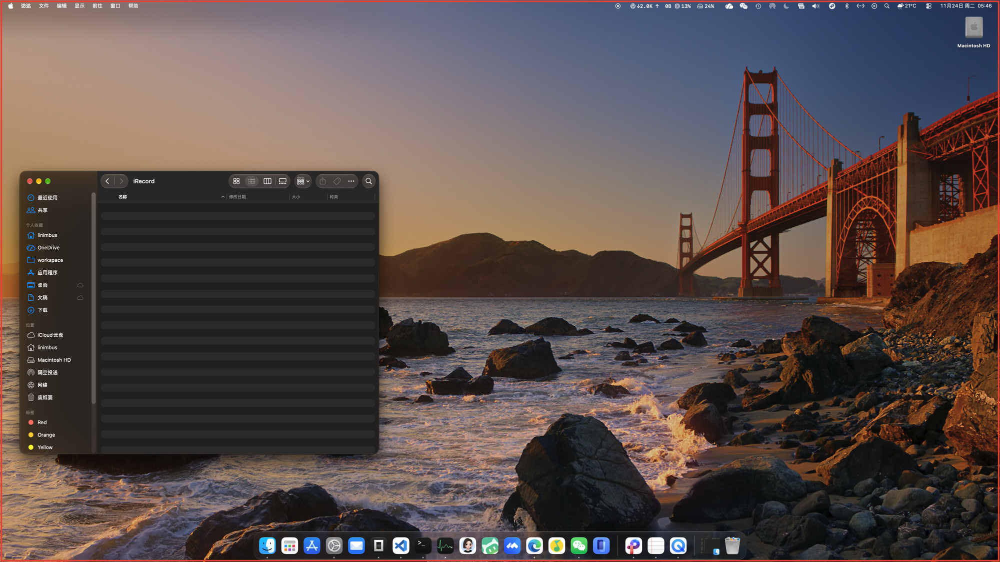
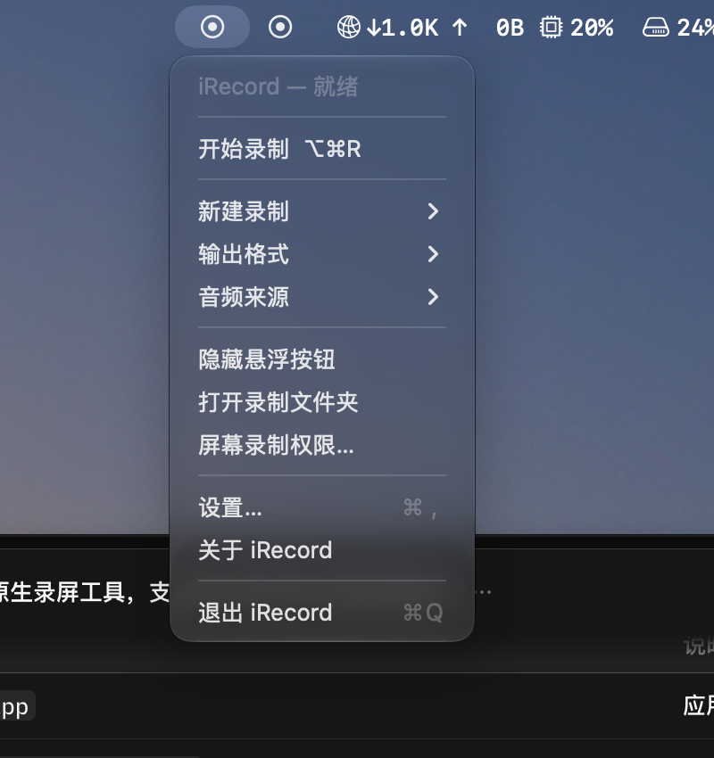
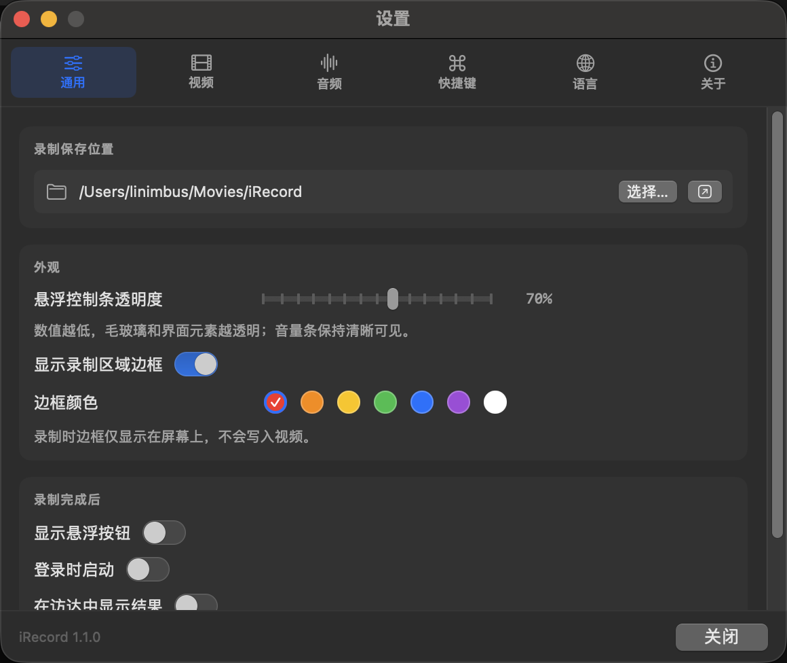
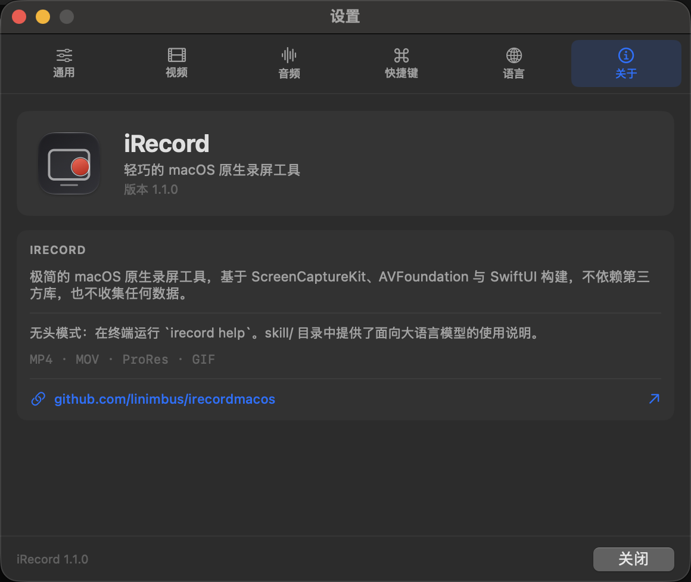

# iRecord · Minimal Native Screen Recorder for macOS

> **v1.1.0** · Menu bar + floating control pill · Full screen / window / region · System audio & microphone · MP4 / MOV / ProRes / GIF · Headless CLI

[中文 README](README.md) · [Headless Skill](skill/irecord-headless/SKILL.md) · [GitHub project](https://github.com/linimbus/irecordmacos)

iRecord is a lightweight screen recorder built entirely with Apple frameworks. It runs as a menu bar accessory with a compact floating controller at the bottom-right of the screen, with no Dock icon. Screen content and system audio are captured with ScreenCaptureKit, video is encoded with AVFoundation, and GIFs are produced with ImageIO. There are no third-party dependencies, no telemetry, and no network access.

---

## Features

- **Three capture scopes**
  - Full screen (the display under the pointer)
  - A specific window, picked from a searchable list
  - A custom region, selected by dragging (`Return` to confirm, `Esc` to cancel)
- **Desktop controls**
  - Menu bar state icon: ready / recording / paused / saving
  - Bottom-right **frosted-glass** floating controller with a simple record dot, full-screen, window, region, and settings buttons; it shows a `00:00:00` timer even when idle, and a `HH:MM:SS` timer, five-cell vertical audio level bar, pause/resume, and stop while recording
  - The floating pill and region overlay use `sharingType = .none`, so **they never appear in the recording**
- **Global shortcuts** (fully remappable in Settings)
  - `⌥⌘R` start / stop recording
  - `⌥⌘P` pause / resume
  - `⌥⌘S` stop and save
- **Audio**
  - Off / system audio / microphone / system audio + microphone
  - System audio is captured by ScreenCaptureKit; the microphone uses the same capture stream
- **Mouse**
  - Show or hide the cursor
  - Optional **mouse click highlights**: the system draws a ring around every click and embeds it in the video
- **Recording area border**
  - Shows a border in the chosen color during full-screen or region recording
  - Disappears immediately when recording stops
  - Displayed on screen only and **never written to the recording**
  - Color options: red, orange, yellow, green, blue, purple, white
- **Multiple output formats**
  - MP4 · H.264 / HEVC
  - MOV · H.264 / HEVC / ProRes 422
  - Animated GIF (converted automatically on stop; configurable width and frame rate)
- **Recording behavior**
  - Pause/resume cuts paused time out of the final file
  - Static screens keep their full duration
  - Optional finish sound, reveal in Finder, and system notification
- **Compact settings**
  - Six tabs: General, Video, Audio, Shortcuts, Language, About
  - Seven languages, applied instantly: English, 简体中文, 日本語, 한국어, Deutsch, Français, Español (plus Follow System)
- **Headless mode**
  - `irecord` records synchronously or as a background session; supports target discovery, pause/resume/stop/status
  - Every command supports `--json`; stdout contains exactly one JSON object
  - `irecord help --json` publishes the full machine-readable capability contract for LLM agents

---

## Screenshots

### Desktop control (idle)



Frosted-glass controller with a `00:00:00` timer, full-screen, window, region, and settings.

### Recording



Timer, five-cell gray audio level bar, pause and stop. The volume bar is unaffected by the control opacity setting.

### Recording area border



The region border is visible on screen while recording, disappears on stop, and is not written into the video.

### Full-screen recording border



Full-screen recordings show a border around the display; the color is selectable in Settings → General → Appearance.

### Menu bar



Menu bar icon and menu: start recording, new recording, output format, audio source, settings, and quit.

### Settings



Settings → General → Appearance, with floating-control opacity, recording border toggle, and border color.

### About



Settings → About: version and the [GitHub project link](https://github.com/linimbus/irecordmacos).

---

## Requirements

- macOS **15.0** or later
- Apple Silicon or Intel Mac (release build is Universal 2)
- Screen Recording permission; Microphone permission for audio input
- Building from source: Xcode 16+ / Swift 5.10+ (verified with Xcode 27.2 / Swift 6.4)

---

## Install & First Launch

### Release package

1. Open `dist/iRecord-1.1.0-macOS.dmg` and drag **iRecord.app** into Applications.
2. The release is ad-hoc signed, so on first launch either:
   - right-click iRecord.app in Finder → **Open**, or
   - run `xattr -dr com.apple.quarantine /Applications/iRecord.app`
3. After launch there is no Dock icon:
   - a circular record icon appears in the menu bar
   - a compact floating controller appears at the bottom-right
4. On the first recording macOS asks for **Screen Recording** permission. If capture still fails after granting, quit and relaunch iRecord.
5. For microphone audio, allow iRecord under System Settings → Privacy & Security → Microphone.

> Rebuilding the ad-hoc signed app may reset the Screen Recording grant because the binary changes.

### Command line

The CLI is bundled inside the app:

```bash
/Applications/iRecord.app/Contents/Helpers/irecord help
```

Or use the standalone binary:

```bash
sudo cp dist/irecord /usr/local/bin/irecord
irecord help --json
```

Prefer the copy inside the app bundle when recording a microphone: it carries the full bundle identity and usage description.

---

## Usage

### Start a recording

Pick any of these:

- Click the red record button in the floating pill: **full screen**
- Click the window icon in the pill: **choose a window**
- Click the region icon in the pill: **drag a region**
- Menu bar icon → **New Recording** → Full Screen / Window / Region
- Press `⌥⌘R` to start or stop a full-screen recording

If the floating pill is hidden, it appears automatically when recording starts and is hidden again when recording ends.

### While recording

- The pill switches to elapsed time, pause/resume, and stop
- `⌥⌘P` pauses or resumes
- `⌥⌘S` or the stop button finishes and saves
- The menu bar icon turns into a red dot while recording and an orange pause symbol while paused

### Output

Files are saved to `~/Movies/iRecord/` by default with names such as `iRecord-2026-11-23-22-10-05.mp4`. The folder is configurable.

---

## Output formats

| Format | Container | Codec | Audio | Notes |
| --- | --- | --- | --- | --- |
| `mp4-h264` | MP4 | H.264 | AAC | Default, best compatibility |
| `mp4-hevc` | MP4 | HEVC | AAC | Smaller files at similar quality |
| `mov-h264` | MOV | H.264 | AAC | Native QuickTime container |
| `mov-hevc` | MOV | HEVC | AAC | QuickTime + HEVC |
| `mov-prores` | MOV | ProRes 422 | AAC | Editing master, very large |
| `gif` | GIF | - | None | Converted on stop; width and fps configurable |

- GIF is silent. The recording is first written to a temporary MP4 and converted when you stop.
- Long GIFs are capped at roughly 1200 frames to bound conversion time and memory.
- ProRes is intended for further editing, not quick sharing.

### Audio scope

- **Full-screen / region**: system audio comes from the current output device and covers the whole system.
- **Window**: ScreenCaptureKit only captures audio belonging to the **captured window's application**. If that window is not playing sound, the audio track is silent. Use full-screen/region capture when you need all system audio.
- **Microphone**: "Microphone" writes a dedicated microphone track; "System + microphone" writes two audio tracks — the microphone first and system audio second. Microphone permission is required.
- **GIF**: always silent.

---

## Settings

The settings window is a fixed-size compact layout:

- **General**: output folder, default format, frame rate, quality, floating pill, floating-pill opacity, recording border and color, launch at login, reveal in Finder, finish sound
- **Video**: format, scale (100% / 75% / 50%), frame rate, quality, GIF width/fps, cursor, mouse click highlights
- **Audio**: off / system / microphone / both, with a shortcut to microphone permissions
- **Shortcuts**: click a field and press a new combination; duplicate detection; reset to defaults
- **Language**: English / 简体中文 / 日本語 / 한국어 / Deutsch / Français / Español / Follow System
- **About**: version, project description, CLI hint

Shortcuts use the Carbon hotkey API. They require no Accessibility permission and work system-wide while iRecord is running.

---

## Headless mode (for LLM agents / automation)

`irecord` is a standalone process and does not need the GUI. Every command accepts `--json`; stdout contains exactly one JSON object and progress goes to stderr.

```bash
# 1. Environment and permissions
irecord doctor --json

# 2. Discover displays and windows (window IDs are ephemeral)
irecord targets --json

# 3. Synchronous 8-second full-screen recording
irecord record --mode screen --duration 8 --output demo.mp4 --json

# 4. A window, with system + microphone audio and click highlights
irecord record --mode window --window 12345 --duration 5 \
  --audio both --mouse-clicks --json

# 5. Select a window by app and title
irecord record --mode window --app Safari --title "Example" --duration 10 --json

# 6. Record an 800×600 region of display 1 as a GIF
irecord record --mode region --display 1 --region 100,200,800,600 \
  --duration 6 --format gif --json

# 7. Background session
irecord start --mode screen --output session.mp4 --json
irecord status --session <id> --json
irecord pause  --session <id> --json
irecord resume --session <id> --json
irecord stop   --session <id> --json     # waits for finalization/conversion
```

### Commands

| Command | Purpose |
| --- | --- |
| `irecord help [--json]` | Human help / full machine-readable capability contract |
| `irecord doctor [--json]` | Check version, permissions, output folder, active session |
| `irecord targets [--json]` | List displays and capturable windows |
| `irecord record [options]` | Record synchronously; `Ctrl+C` in an interactive terminal, or `--duration` (required in automation) |
| `irecord start [options]` | Start a background session and return a session id |
| `irecord pause/resume/stop/status` | Control a background session |
| `irecord config [--json]` | Show settings shared with the GUI |
| `irecord version` | Print `iRecord 1.1.0` |

### JSON output

Success:

```json
{
  "ok": true,
  "output": "/Users/me/Movies/iRecord/iRecord-2026-11-23-22-10-05.mp4",
  "format": "mp4-h264",
  "duration": 8.02,
  "width": 3024,
  "height": 1964,
  "fileSize": 5242880,
  "audio": true
}
```

Failure:

```json
{
  "ok": false,
  "error": "Screen Recording permission is not granted.",
  "code": "screen_permission_denied",
  "hint": "Open System Settings → Privacy & Security → Screen Recording..."
}
```

Background sessions are persisted to `~/Library/Application Support/iRecord/sessions/<id>.json`. `stop` polls this file until the session completes; the default timeout is 300 seconds and can be changed with `--timeout`.

### Exit codes

| Code | Meaning |
| --- | --- |
| 0 | Success |
| 1 | General failure |
| 2 | Invalid arguments |
| 3 | Missing screen or microphone permission |
| 4 | Capture target not found |
| 5 | Output path not writable or already exists |
| 6 | Timed out |
| 130 | Cancelled with `Ctrl+C` |

### Permission notes

- **Screen Recording permission belongs to the process that runs `irecord`.** Enable Terminal, iTerm, your IDE, or the automation host under System Settings → Privacy & Security → Screen Recording, not only iRecord.
- Restart the host process if macOS does not pick up the grant.
- For microphone audio, prefer `/Applications/iRecord.app/Contents/Helpers/irecord`, or grant access through the GUI first. The standalone binary embeds `NSMicrophoneUsageDescription`.
- `irecord start` detaches with `setsid`. Some environments cannot show a TCC prompt for a detached process; in that case use synchronous `record --duration N`.
- A foreground `record` without `--duration` is rejected when stdin is not a TTY, so agents cannot hang indefinitely.
- Window capture only captures audio from the captured application. Use full-screen/region capture for all system audio.

### Agent entry points

- Machine-readable capabilities: `irecord help --json`
- Full agent workflow and recovery guide: [`skill/irecord-headless/SKILL.md`](skill/irecord-headless/SKILL.md)
- Recommended loop: `doctor` → `targets` → `record --duration` → check `ok` and `output`

---

## Build from source

### One-click release

```bash
./release.sh
```

The script automatically:

- runs unit tests
- builds a Universal 2 app (arm64 + x86_64)
- signs the `.app`
- creates the `.app`, `.zip`, `.dmg`, and standalone CLI
- writes `SHA256SUMS.txt`
- verifies signing, version, architectures, DMG contents, and checksums

Useful options:

```bash
./release.sh --open          # open the dist folder when done
./release.sh --no-tests      # skip tests
CODESIGN_IDENTITY="Developer ID Application: ..." ./release.sh
```

`make release` runs the same script.

### Manual build

```bash
git clone <repository> iRecordMacOS
cd iRecordMacOS

swift build                 # debug build
swift test                  # unit tests
make dist                   # universal release (arm64 + x86_64)
open dist/iRecord.app
```

Artifacts:

- `dist/iRecord.app` — the app (CLI inside `Contents/Helpers/irecord`)
- `dist/irecord` — standalone CLI
- `dist/iRecord-1.1.0-macOS.zip` — portable archive
- `dist/iRecord-1.1.0-macOS.dmg` — installer image (includes READMEs, LICENSE, the skill, an Applications shortcut, and a standalone `CLI/irecord`)
- `dist/SHA256SUMS.txt` — checksums

To sign/notarize with your own identity:

```bash
CODESIGN_IDENTITY="Developer ID Application: ..." make dist
```

The committed release artifacts are ad-hoc signed and not notarized.

---

## Project layout

```
.
├── Package.swift
├── Sources
│   ├── iRecordCore          # capture engine, settings, localization, GIF, hotkeys, control protocol
│   ├── iRecordApp           # menu bar app, floating pill, settings, window/region pickers
│   └── iRecordCLI           # irecord headless CLI and background sessions
├── Tests/iRecordCoreTests
├── Resources                # Info.plist, entitlements, icon
├── scripts                  # build.sh, icon generator
├── skill/irecord-headless   # LLM-oriented skill
├── dist                     # build artifacts
├── README.md
└── README_en.md
```

All implementation uses Apple frameworks:

- ScreenCaptureKit — display/window/region capture, system audio, microphone, click highlights
- AVFoundation — AVAssetWriter (H.264/HEVC/ProRes + AAC)
- ImageIO — GIF encoding
- SwiftUI + AppKit — menu bar, floating pill, settings, region selection
- Carbon — global hotkeys
- POSIX Unix domain sockets — headless session control

---

## Privacy

- Everything runs locally. No network access, analytics, or telemetry.
- Settings and session metadata live in `~/Library/Application Support/iRecord/`.
- Recordings are written to the folder you choose.
- Screen content can contain private information. Choose the capture scope and output location deliberately.

---

## Known limitations

- Protected windows (some password fields, DRM content) may be blank or not captured.
- A full-screen recording captures one display at a time; use window/region mode or record each display separately.
- GIF output is silent and conversion of long recordings takes time.
- Release builds are ad-hoc signed; Gatekeeper prompts on other Macs and requires right-click → Open.
- Headless Screen Recording permission is held by the host process; different terminals/automation hosts may need separate grants.
- A hidden floating pill appears automatically when recording starts. If you hide it again during recording, the menu bar icon and shortcuts still work.

---

## Version

**1.1.0** — adds region/full-screen recording borders with color selection, floating-control opacity, a five-cell gray audio meter, independent microphone capture, a full-screen button, idle `00:00:00` timer, frosted-glass controls, and a one-click release script; fixes microphone audio, level display, and interface crashes.

## License

MIT License. See [LICENSE](LICENSE).
